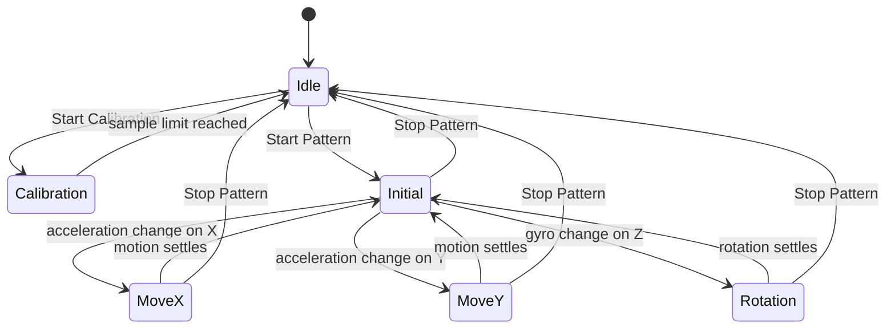

# Motion-Based Authentication Prototype

A Qt Quick and C++ prototype for capturing a short motion gesture as an authentication pattern. The project connects live accelerometer and gyroscope readings to a calibration and gesture-segmentation state machine, estimates movement/rotation, and stores the resulting ordered steps for comparison.

## Signal processing and state machine

`Main.qml` samples the Qt Sensors accelerometer and gyroscope at 25 Hz and passes horizontal acceleration and Z-axis angular velocity into `DataReadingHandler`. The handler exposes readings and derived values to QML through `Q_PROPERTY` values, allowing the UI to display sensor traces and current movement estimates.

Calibration collects roughly 100 samples for each sensor channel, computes the channel mean as a resting-noise estimate, and records the observed range. During gesture capture, the handler subtracts the estimated noise and zeros readings inside the calibrated range. Acceleration changes greater than the configured threshold start an X- or Y-axis movement segment; a gyro change over its threshold starts a rotation segment. The handler numerically integrates samples at the configured data rate and treats five consecutive near-zero readings as the end of a segment. Each completed segment is appended as movement magnitude, direction, and angle.



## Pattern representation and current scope

`Pattern` stores each gesture as a JSON array of `{movement, direction, angle}` steps. `Pattern::isPatternMatch` first requires equal sequence lengths, then compares movement and angle values against ±25% bounds. Although direction is recorded, the current comparison function does not compare it. The “Start Authentication” and “Stop Authentication” QML buttons are placeholders, so the enrollment-to-authentication flow is not connected in the interface yet.

The implementation is useful for examining sensor calibration, threshold-based segmentation, numerical integration, and pattern representation. Its simple thresholds and tolerance checks are a prototype, not a robust or security-grade biometric matcher.

## Requirements

- CMake 3.16 or newer
- A C++17 compiler
- Qt 6.4 or newer, with the Quick and Sensors modules
- A device or host that exposes accelerometer and gyroscope sensors for live input

## Build

From this directory, configure and build with CMake:

```bash
cmake -S . -B build
cmake --build build
```

Run the generated `appQtSensorAuth` executable from the build output. Sensor availability depends on the host operating system and hardware; a desktop machine without motion sensors may build the app but cannot provide representative live gesture input.

## Project files

- `Main.qml` defines the Qt Quick interface and sensor connections.
- `DataReadingHandler.*` handles calibration, filtering, and gesture-state transitions.
- `Pattern.*` stores gesture steps and provides the pattern comparison helper.
- `ProgressXYBar.qml` and `ProgressZBar.qml` visualize sensor readings.
- [`Report.pdf`](Report.pdf) contains the project report.
